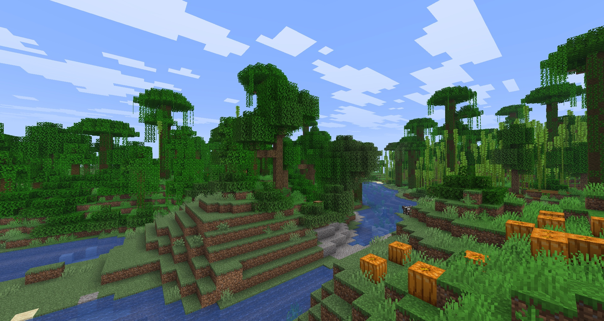
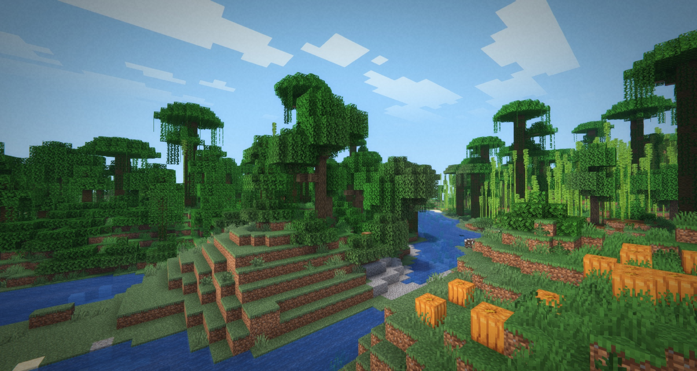

# Filmicsoft

A lightweight, cinematic post-processing shader pack for Minecraft: Java Edition
(Iris + Sodium). Soft diffusion, bloom, Lightroom-style color grading, chromatic
fringe and film grain. Written for GLSL 330 so it runs on macOS (OpenGL 4.1),
Windows and Linux: no compute shaders, no SSBOs.

| Vanilla | Filmicsoft |
|---|---|
|  |  |

## Why Filmicsoft

Realistic Minecraft shaders usually get their look from global illumination,
ray tracing or path tracing. Those look great but cost a lot of frame time and
need a strong GPU. Filmicsoft goes the other way: get as close to a realistic,
filmic image as possible **without GI or ray tracing**, and stay fast.

- **Performance first.** Every pass is measured on the GPU (`tools/bench`, see
  `BENCHMARK.md`) and kept only if it earns its cost. The whole pack adds about
  1.2 ms per frame at 1080p on an Apple M4.
- **Realism from cheap tricks.** Deferred lighting with a soft sun/moon, sky
  ambient and warm torch light. Vanilla's sky-light level stands in for
  shadows, and distance haze matches the sky. Then a film look on top: bloom,
  diffusion, colour grading and grain.
- **Runs on macOS.** Most shader packs need OpenGL features that macOS doesn't
  have (it stops at OpenGL 4.1), so they fail to load or render wrong on Macs.
  Filmicsoft is written for GLSL 330: no compute shaders, no SSBOs. It is
  built and tested on Apple Silicon, and should work the same on Windows and
  Linux.
- **Light on your system.** Small render targets, a packed G-buffer and
  low-resolution bloom keep memory use and bandwidth low, which also matters
  on laptops and integrated GPUs.

## Install

1. Install [Iris](https://modrinth.com/mod/iris) and [Sodium](https://modrinth.com/mod/sodium).
2. Download `Filmicsoft-<version>.zip` from the
   [Releases](../../releases) page (or Modrinth) and drop it, unzipped, into
   `.minecraft/shaderpacks/`.
3. In game: Video Settings > Shader Packs > Filmicsoft > Apply.

## Layout

- `pack/shaders/` - the shader pack itself (installed as `Filmicsoft` in `shaderpacks/`)
  - `lib/options.glsl` - every user option, shared by all passes
  - `gbuffers_*.fsh` - write the packed G-buffer (`lib/gbuf.glsl`); water is lit directly
  - `deferred.fsh` - lighting: sun/moon direction, sky ambient, torch light
  - `lib/lighting.glsl` - the lighting model (no shadow maps)
  - `composite.fsh` - atmosphere (haze, sun glow, fluid fog), before bloom and FXAA
  - `gbuffers_skybasic.fsh`, `lib/sky.glsl` - sky gradient that fog and clouds fade toward
  - `composite1-3.fsh` - bloom prefilter, two 4x downsamples, diffusion source
  - `final.fsh` - bloom/diffusion mix, grading, lens, grain
- `scripts/install.sh` - copy the pack into a game directory's `shaderpacks/`
- `tools/glcheck/` - compile every pass with the macOS GLSL compiler
- `tools/bench/` - time every pass on the GPU (see `BENCHMARK.md`)

## Workflow

```sh
tools/glcheck/run.sh          # compile check (macOS)
tools/bench/run.sh            # per-pass GPU timing (macOS)
scripts/install.sh            # install into the default game directory
scripts/install.sh "/path/to/.minecraft"   # or another one (also: MINECRAFT_DIR)
```

Then in game: Video Settings > Shader Packs > Filmicsoft > Apply. After editing
files, press R in the shader screen (or re-apply) to reload. Check
`<game dir>/logs/latest.log` if the pack reports a failed load.

## Gotchas learned

- Buffer-format constants (`const int colortex4Format = RGBA16F;`) must be in a
  comment block; `RGBA16F` is not a real GLSL identifier.
- Iris pastes option values in as plain text. Never write `-OPTION` (a negative
  value becomes `--0.10`, a decrement); copy the option into a local variable
  first. `tools/glcheck` substitutes values the same way, so it catches this.
- `#version 330 compatibility` is fine; Iris translates it for macOS's core profile.
- The mipmap flag is only valid in composite-stage programs, not `final`.

## Status

Tested: Minecraft 26.3, Fabric, Iris 1.11.7, Sodium 0.9.2, macOS (Apple Silicon).
Not yet tested: Windows, Linux.
Planned: presets, optional cheap SSAO, light shafts.

## License

MIT, see [LICENSE](LICENSE).
