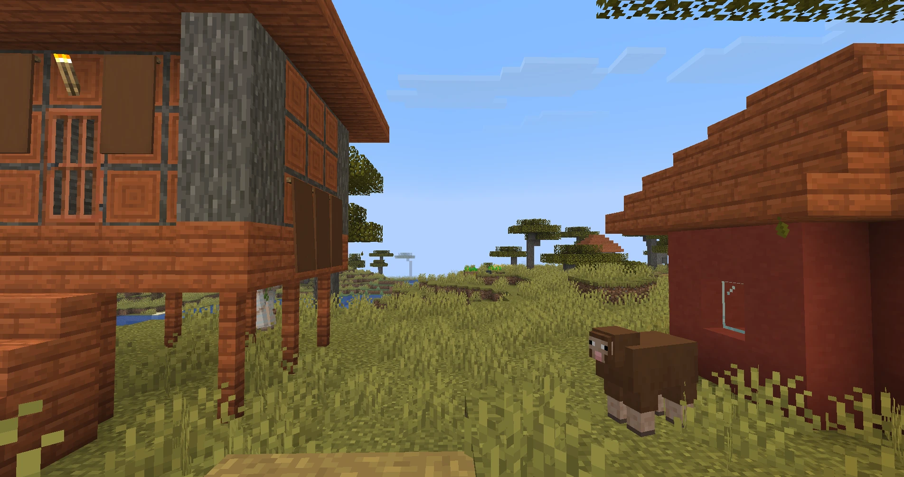
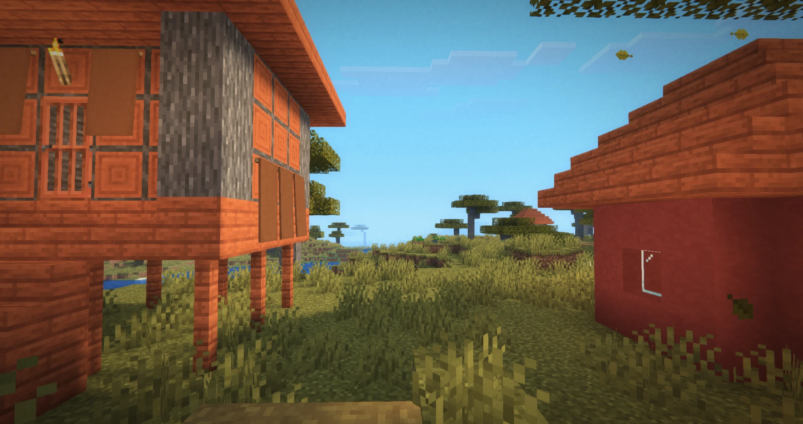
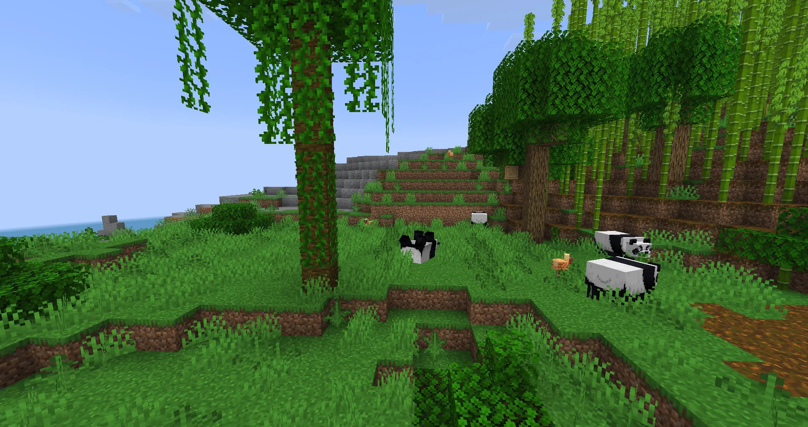
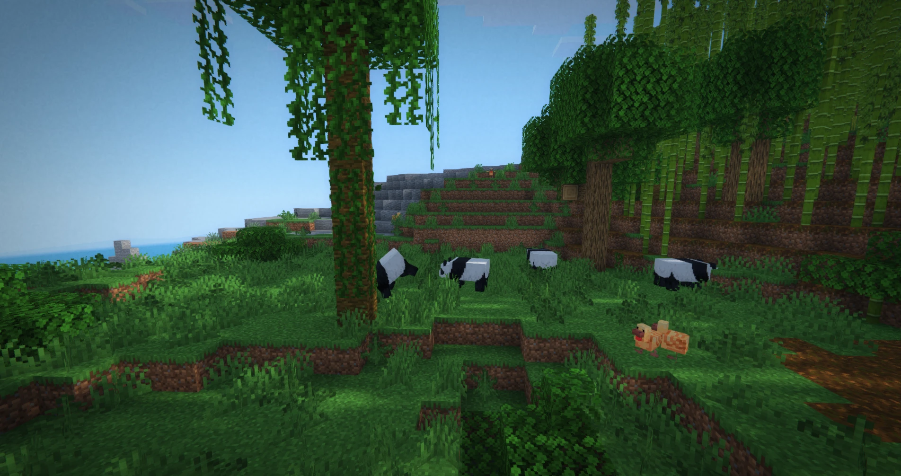
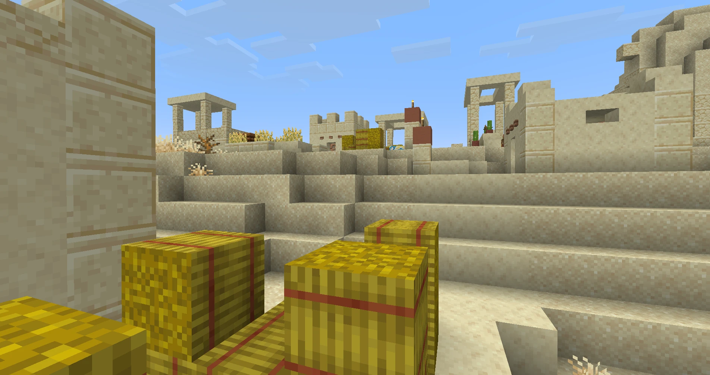
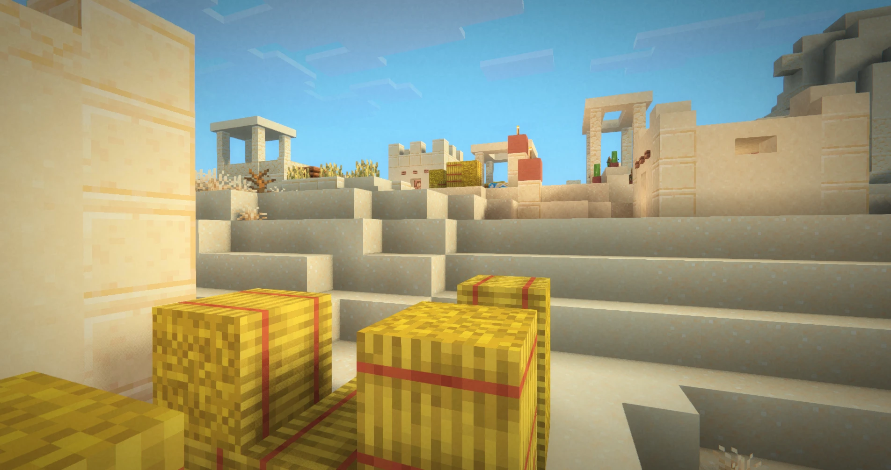

# Filmicsoft

An extremely high-performance cinematic shader pack for Minecraft: Java Edition
(Iris + Sodium). Real sun and moon shadows, atmospheric haze, soft diffusion,
bloom, Lightroom-style color grading and film grain, at frame rates well above
what you would expect for this look. Written for GLSL 330 so it runs on macOS (OpenGL 4.1),
Windows and Linux: no compute shaders, no SSBOs.

| Vanilla | Filmicsoft |
|---|---|
|  |  |
|  |  |
|  |  |

## Why Filmicsoft

Realistic Minecraft shaders usually get their look from global illumination,
ray tracing or path tracing. Those look great but cost a lot of frame time and
need a strong GPU. Filmicsoft goes the other way: get as close to a realistic,
filmic image as possible **without GI or ray tracing**, and stay fast.

- **Extreme performance.** Surfaces are lit in a single forward pass and every
  pass is measured on the GPU (`tools/bench`, see `BENCHMARK.md`) and kept only
  if it earns its cost. The post-processing chain adds about 1.2 ms per frame at
  1080p on an Apple M4, and in side-by-side play it holds noticeably higher
  frame rates than packs marketed as ultra-light. The shadow map is extra and
  can be turned off or made cheaper (see Options).
- **Realism from cheap tricks.** Forward lighting with a soft sun/moon, sky
  ambient and warm torch light, and a real filtered shadow map for the sun and
  moon (with a sky-light fake as the fallback when it is off or out of range).
  Distance haze matches the sky. Then a film look on top: bloom, diffusion,
  colour grading and grain.
- **Runs on macOS.** Most shader packs need OpenGL features that macOS doesn't
  have (it stops at OpenGL 4.1), so they fail to load or render wrong on Macs.
  Filmicsoft is written for GLSL 330: no compute shaders, no SSBOs. It is
  built and tested on Apple Silicon, and should work the same on Windows and
  Linux.
- **Light on your system.** Surfaces are lit where they are drawn (no
  G-buffer, no deferred pass) and bloom runs at low resolution, keeping
  memory use and bandwidth low; that also matters on laptops and integrated GPUs.

## What's new in 2.0.0

- **Real shadows, on by default.** A shadow map with soft, filtered edges.
  Distance, resolution, and whether mobs and grass cast shadows are options.
  Turn `ENABLE_SHADOWS` off for the cheap sky-light version.
- **Emissive glow per texel.** Lantern glass, flames and lava glow; the dark
  metal frame of a lantern or the stick of a torch no longer does.
- **Highlight rolloff and retuned light.** A softer highlight curve keeps sand,
  snow and other pale blocks textured instead of blowing out to flat cream.
- **Fewer fullscreen passes** (two bloom passes instead of three).

## Install

1. Install [Iris](https://modrinth.com/mod/iris) and [Sodium](https://modrinth.com/mod/sodium).
2. Download `Filmicsoft-<version>.zip` from the
   [Releases](../../releases) page (or Modrinth) and drop it into
   `.minecraft/shaderpacks/`. (A zip works as is; no need to unzip it.)
3. In game: Video Settings > Shader Packs > Filmicsoft > Apply.

## Compatibility

- **Iris + Sodium** (Fabric): the main target; built and tested here.
- **Fabulously Optimized**: works. The modpack ships Iris and Sodium, so
  drop Filmicsoft into `shaderpacks/` as above. Other Fabric performance
  mods (Lithium, FerriteCore, ImmediatelyFast, Entity Culling) don't affect
  the pack.
- **OptiFine**: should work but untested. The pack only uses the standard
  shader-pack format (GLSL 330, no Iris-only features), which OptiFine also
  reads.

## Layout

- `pack/shaders/` - the shader pack itself (installed as `Filmicsoft` in `shaderpacks/`)
  - `lib/options.glsl` - every user option, shared by all passes
  - `gbuffers_*.fsh` - draw and light each surface in one go (forward shading)
  - `lib/surface.glsl` - per-surface lighting, shadow map, sheen and haze for opaque geometry
  - `shadow.fsh`, `shadow.vsh` - the shadow map pass
  - `lib/lighting.glsl` - the lighting model (shadow map lookups, sky-light fake as fallback, highlight rolloff, emissive glow)
  - `lib/fog.glsl` - atmosphere (haze, sun glow, fluid fog), applied where each surface is lit, and to the sky underwater
  - `gbuffers_skybasic.fsh`, `lib/sky.glsl` - sky gradient that fog and clouds fade toward
  - `composite1-2.fsh` - bloom prefilter and downsample, diffusion source
  - `final.fsh` - bloom/diffusion mix, grading, lens, grain
- `scripts/install.sh` - copy the pack into a game directory's `shaderpacks/`
- `tools/glcheck/` - compile every pass with the macOS GLSL compiler
- `tools/bench/` - time every pass on the GPU (see `BENCHMARK.md`)

## Workflow

```sh
tools/glcheck/run.sh          # compile check (macOS)
tools/bench/run.sh            # per-pass GPU timing (macOS)
scripts/install.sh            # install into the Prism instance "26.3" (else the vanilla directory)
scripts/install.sh "/path/to/.minecraft"   # or another one (also: MINECRAFT_DIR, PRISM_INSTANCE)
```

Then in game: Video Settings > Shader Packs > Filmicsoft > Apply. After editing
files, press R in the shader screen (or re-apply) to reload. Check
`<game dir>/logs/latest.log` if the pack reports a failed load.

## Gotchas learned

- Buffer-format constants (`const int colortex4Format = RGBA16F;`) must be in a
  comment block; `RGBA16F` is not a real GLSL identifier.
- Iris pastes option values in as plain text. Never write `-OPTION` (a negative
  value becomes `--0.10`, a decrement); copy the option into a local variable
  first. `tools/glcheck` substitutes values the same way, so it catches this.
- `#version 330 compatibility` is fine; Iris translates it for macOS's core profile.
- The mipmap flag is only valid in composite-stage programs, not `final`.

## Status

Tested: Minecraft 26.3, Fabric, Iris 1.11.7, Sodium 0.9.2, macOS (Apple Silicon),
on the official launcher through Prism.
Not yet tested: Windows, Linux.
Planned: presets, optional cheap SSAO, light shafts.

## License

MIT, see [LICENSE](LICENSE).
