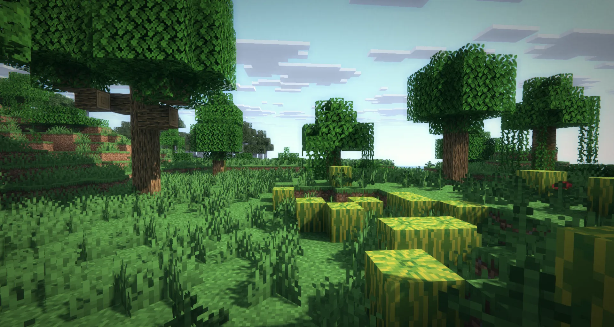
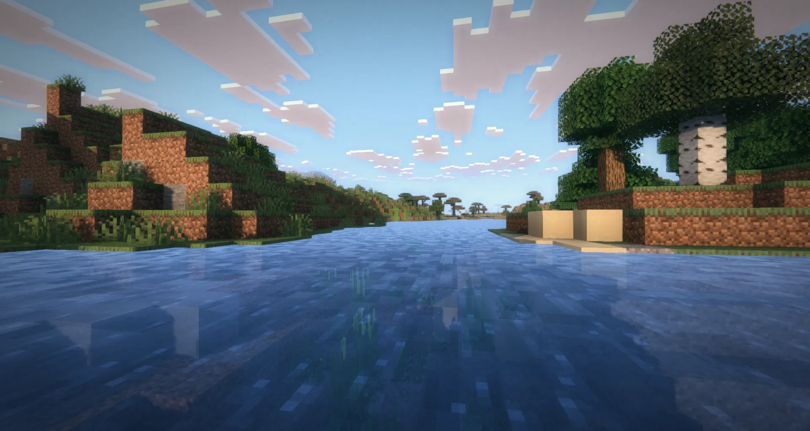
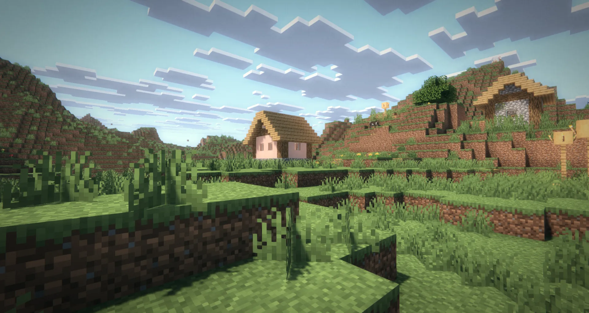
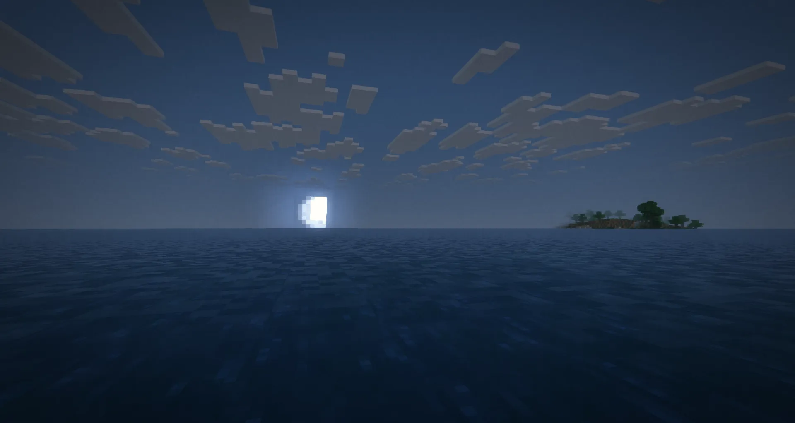
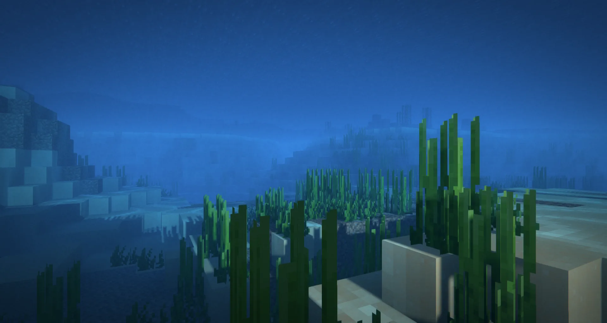
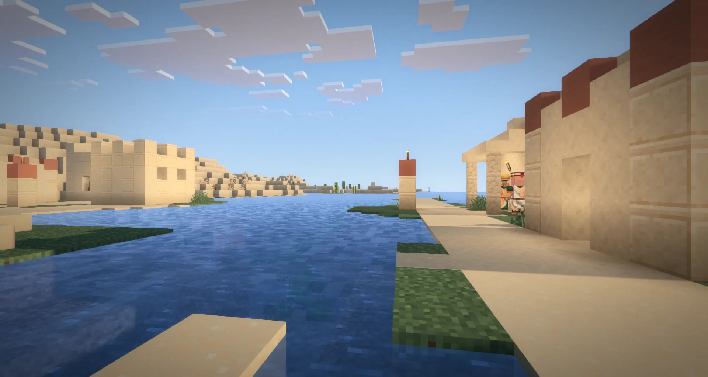

# Filmicsoft

A high-performance, semi-realistic shader pack for Minecraft: Java Edition
(Iris + Sodium). It adds light and atmosphere without repainting the game, and
runs on macOS, Windows and Linux.

|  |  |
|---|---|
|  |  |
|  |  |

## Features

**Lighting and shadows**
- Real sun and moon shadows from a filtered shadow map, reaching 64 blocks by
  default (up to 256), with a soft sky-light shadow beyond it
- Soft shadows that behave like real ones: crisp where an object meets the
  ground, widening and fading with distance, so long sunset shadows melt away
- Shadows stay fixed to the world while you walk and look around
- Optional shadows from mobs and grass
- Thin blocks (leaves, plants, panes, fences) cast clean shadows without
  shading themselves
- Light filters softly through leaves, grass and vines
- Warm torch and block light; lava, glowstone, lanterns and other light
  sources glow
- Golden mornings and evenings: the sun warms and dims toward the horizon
- Adjustable sun strength, sky ambient and moon / night brightness

**Sky and atmosphere**
- Sky scattering: deeper blue overhead, a warm glow around the sun
- Sun-lit clouds
- Distance haze that matches the sky, plus a horizon mist
- God rays
- Rain atmosphere with wet-looking ground

**Water**
- Water that reflects the sky, with blocky ripples in keeping with the game
- Underwater look: light absorption, teal fog and caustics on the sea floor

**Movement**
- Waving leaves, grass and plants with adjustable wind; shadows sway with them

**Film look**
- Bloom, held back on bright sand and stone so they don't wash out
- Soft diffusion
- Colour grading: exposure, contrast, black lift, saturation, vibrance, a
  colour intensity limit and tone colour presets
- Highlight roll-off, so sand and snow don't clip to flat white
- Chromatic aberration: a subtle lens fringe toward the screen edges
- Film grain, vignette and FXAA anti-aliasing

## Why Filmicsoft

Realistic Minecraft shaders usually get their look from global illumination,
ray tracing or path tracing. Those look great but cost a lot of frame time and
need a strong GPU, and they often push the game so far toward photo-realism
that it stops feeling like Minecraft. Filmicsoft goes the other way: a
realistic-leaning image **without GI or ray tracing**, fast enough for everyday
play.

- **Maintains Minecraft's original feel.** Vanilla textures, block shapes, sky,
  clouds, sun and moon are kept. Light, shadow, haze and colour are improved
  around them, never replaced, so the world still reads as Minecraft.
- **High performance.** Every pass is measured on the GPU (`tools/bench`,
  see `BENCHMARK.md`) and kept only if it earns its cost. The post-processing
  chain adds about 1.2 ms per frame at 1080p on an Apple M4.
  Every effect can be switched off on its own, and the shadow map can be turned
  off or made cheaper on the Shadows page.
- **Runs everywhere, macOS included.** Filmicsoft is written for GLSL 330 (no
  compute shaders, no SSBOs), so it runs the same on Windows, Linux and macOS.
  That makes it fully supported on Macs, where OpenGL stops at 4.1 and most
  shader packs fail to load or render wrong. It is built on Apple Silicon.
- **Light on your system.** Surfaces are lit where they are drawn (no
  G-buffer, no deferred pass) and bloom runs at low resolution, keeping
  memory use and bandwidth low; that also matters on laptops and integrated GPUs.

## What's new in 2.3.0

- **Shadows hold still.** Block and grass shadows no longer crawl or shimmer
  while you walk, and no longer switch on and off as you turn the camera. Only
  your own shadow moves with you.
- **Shadows that fall off like real ones.** Edges are crisp where an object
  meets the ground and widen and fade further out, so at sunset a sugar cane's
  shadow melts away instead of running on for 30 blocks at full strength.
- **No more shadow flashes at sunset.** Long shadows of grass, plants and thin
  blocks no longer pop in and out as you walk.
- **Shadow Antialiasing** is now a simple on/off switch (Shadows page); the
  sample count follows the edge softness on its own. Shadow edges are a little
  softer by default.

### 2.2.0

- **Shadows reach further.** Shadow Distance now defaults to 64 blocks (was 36)
  and the slider goes up to 256. Shadows no longer fade out halfway: the switch
  to the soft sky-light shadow starts at 85% of the distance, where haze hides it.
- **Cheap at range.** Close shadows look the same as before; past 16 blocks edge
  smoothing tapers off, and past 32 blocks grass and small plants stop casting
  and leaves cast as solid blocks, where those details are smaller than a
  shadow pixel anyway.
- **Thin blocks no longer shade themselves.** Leaf litter, mangrove roots,
  bamboo, flowers, glass panes, bars, chains, fences, doors, rails and similar
  blocks could throw a shadow across their own sunlit side, worst at noon.
- **New screenshots and wording.** The README now says what the pack is for:
  semi-realistic, fast, and true to the feel of Minecraft.

### 2.1.3

- **Sand and stone no longer blown out.** With the stronger bloom, bright ground
  such as sand, cobblestone and snow washed out to near white. Bright terrain now
  keeps only part of the bloom that lands on it, most strongly right around you
  and easing off with distance, so nearby ground keeps its texture while distant
  dunes stay hazy and bright. Grass, dirt, shade, the sky and the glow around
  torches and lava are unchanged.

### 2.1.2

- **Shadow edge line fixed.** At low sun a thin bright line ran along the base
  of walls. Shadows now use a warped map that is denser near the player, a
  smaller depth bias and back-face handling, and are cast from a light turned
  25 degrees from the sun so low sun never runs along a wall. The sun and sky
  keep their vanilla path.
- **Dawn sunlight fixed.** Just before sunrise the sun's colour arrived from the
  moon's side; it now comes from the sun.
- **More bloom.** Bloom Strength now defaults to 0.75, and Bloom and its slider
  moved to the Environment page.

### 2.1.1

- **Block-breaking cracks fixed.** Mining a block showed opaque dark and orange
  blotches instead of cracks. The crack overlay now has its own program and
  blends like vanilla, so the block shows through.
- **Shadow Antialiasing Samples** (Shadows page): 0 for hard edges, up to 64
  for very smooth ones. Default stays 4. Shadow resolution now goes up to 4096.
- **Wind Strength** (Environment page): how far plants sway when Waving is on.
  Default stays 1.0.
- Rain Mood is renamed **Rain Atmosphere**.

### 2.1.0

- **A world that moves.** Waving plants, sky scattering (deeper blue overhead,
  warm glow around the sun), sun-lit clouds and a horizon mist, a rain mood
  with wet ground, water that reflects the sky with blocky ripples, and an
  underwater look with absorption, teal fog and caustics.
- **Golden mornings and evenings.** Sun and sky dim together toward the horizon
  and the low sun turns gold. Sun Strength now defaults to 2.0 (range 1.0 to
  3.0) and the shadow map to 36 blocks.
- **Colour grading presets.** Pick a tone-colour preset and how strongly it
  tints shadows, midtones and highlights.
- **A shorter menu.** Settings that were tuned and settled are now fixed, so the
  menu keeps only what people adjust: effect switches, Environment, Lighting,
  Shadows, Grading. The colour mixer and calibration are gone. If you had saved
  values for removed options, they are ignored and the shipped look is used.
- **Fast.** Post-processing costs about 1.2 ms at 1080p on an Apple M4.

### 2.0.0

- **Real shadows, on by default.** A shadow map with soft, filtered edges.
  Distance, resolution, and whether mobs and grass cast shadows are options.
  Turn `ENABLE_SHADOWS` off for the cheap sky-light version.
- **Emissive glow per texel.** Lantern glass, flames and lava glow; the dark
  metal frame of a lantern or the stick of a torch no longer does.
- **Highlight rolloff and retuned light.** A softer highlight curve keeps sand,
  snow and other pale blocks textured instead of blowing out to flat cream.
- **Fewer fullscreen passes** (two bloom passes instead of three).

## Install

1. Install [Iris](https://modrinth.com/mod/iris) and [Sodium](https://modrinth.com/mod/sodium).
2. Download `Filmicsoft-<version>.zip` from the
   [Releases](../../releases) page (or Modrinth) and drop it into
   `.minecraft/shaderpacks/`. (A zip works as is; no need to unzip it.)
3. In game: Video Settings > Shader Packs > Filmicsoft > Apply.

## Compatibility

- **Iris + Sodium** (Fabric): the main target; built and tested here.
- **Fabulously Optimized**: works. The modpack ships Iris and Sodium, so
  drop Filmicsoft into `shaderpacks/` as above. Other Fabric performance
  mods (Lithium, FerriteCore, ImmediatelyFast, Entity Culling) don't affect
  the pack.
- **OptiFine**: should work but untested. The pack only uses the standard
  shader-pack format (GLSL 330, no Iris-only features), which OptiFine also
  reads.

## Layout

- `pack/shaders/` - the shader pack itself (installed as `Filmicsoft` in `shaderpacks/`)
  - `lib/options.glsl` - every user option, shared by all passes
  - `gbuffers_*.fsh` - draw and light each surface in one go (forward shading)
  - `lib/surface.glsl` - per-surface lighting, shadow map, sheen and haze for opaque geometry
  - `shadow.fsh`, `shadow.vsh` - the shadow map pass
  - `lib/lighting.glsl` - the lighting model (shadow map lookups, sky-light fake as fallback, highlight rolloff, emissive glow)
  - `lib/fog.glsl` - atmosphere (haze, sun glow, fluid fog), applied where each surface is lit, and to the sky underwater
  - `gbuffers_skybasic.fsh`, `lib/sky.glsl` - sky gradient that fog and clouds fade toward
  - `composite1-2.fsh` - bloom prefilter and downsample, diffusion source
  - `final.fsh` - bloom/diffusion mix, grading, lens, grain
- `scripts/install.sh` - copy the pack into a game directory's `shaderpacks/`
- `tools/glcheck/` - compile every pass with the macOS GLSL compiler
- `tools/bench/` - time every pass on the GPU (see `BENCHMARK.md`)

## Workflow

```sh
tools/glcheck/run.sh          # compile check (macOS)
tools/bench/run.sh            # per-pass GPU timing (macOS)
scripts/install.sh            # install into the Prism instance "26.3" (else the vanilla directory)
scripts/install.sh "/path/to/.minecraft"   # or another one (also: MINECRAFT_DIR, PRISM_INSTANCE)
```

Then in game: Video Settings > Shader Packs > Filmicsoft > Apply. After editing
files, press R in the shader screen (or re-apply) to reload. Check
`<game dir>/logs/latest.log` if the pack reports a failed load.

## Gotchas learned

- Buffer-format constants (`const int colortex4Format = RGBA16F;`) must be in a
  comment block; `RGBA16F` is not a real GLSL identifier.
- Iris pastes option values in as plain text. Never write `-OPTION` (a negative
  value becomes `--0.10`, a decrement); copy the option into a local variable
  first. `tools/glcheck` substitutes values the same way, so it catches this.
- `#version 330 compatibility` is fine; Iris translates it for macOS's core profile.
- The mipmap flag is only valid in composite-stage programs, not `final`.

## Status

Tested: Minecraft 26.3, Fabric, Iris 1.11.7, Sodium 0.9.2, on macOS (Apple
Silicon, official launcher through Prism) and Windows.
Not yet tested: Linux.

## License

MIT, see [LICENSE](LICENSE).
